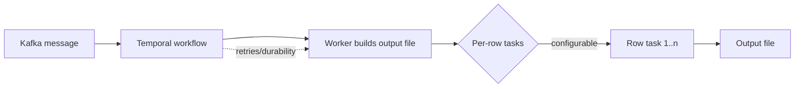
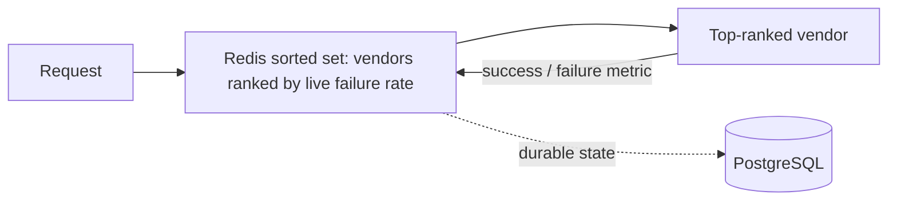

<h1 align="center">Mohammed Sadath Khan</h1>

  <b>Backend & distributed systems engineer</b> · payments, fintech, GenAI 
  5+ years at Flipkart & Yubi · MS CS @ UALR (4.0 GPA)

  
  
  
  

---

## Impact, in numbers

| | What I built | Where |
|---|---|---|
| 💸 **$5M / year saved** | Wallet write-off flow to reconcile unrecoverable payment amounts | Flipkart |
| 🛒 **$1B in sales handled** | Migrated payment services from VMs to Kubernetes and load-tested for Big Billion Days | Flipkart |
| 📈 **+$50K / month revenue** | Temporal + Kafka framework for resilient bulk-file processing | Yubi |
| 🔔 **500K+ pushes / month** | Firebase-based push notification framework (mobile + web) | Yubi |
| 📉 **-25% infra cost** | Led Golang → Java migration of a notification service, removed AWS Lambda | Yubi |

---

## How I think about systems

**Resilient bulk processing** (the pattern behind the Temporal framework)

**Real-time vendor failover**

*(Conceptual diagrams of patterns I've designed, not proprietary code.)*

---

## Things I build on my own

- 🎬 **[AdSlot AI](LINK)**: FastAPI + Whisper + Claude API that analyzes video transcripts and recommends optimal ad-break timestamps. Deployed.
- 🛡️ **[Incident-Based Risk Assessment](LINK)**: LangGraph + RAG pipeline that compares code changes against historical incidents in a vector DB, flags risky deploys, auto-approves safe ones.
- 🔐 **[PrivacyGuard](LINK)**: Python/FastAPI on Kubernetes. Pulls from search, social, and breach sources (HaveIBeenPwned) and uses LLMs to generate weighted PII exposure reports.
- ⚙️ **[MarketGen](LINK)**: n8n + Supabase marketing automation that generates on-brand images, blogs, and videos with LLMs.

---

## Stack

<b>Core</b>

`Java` `Go` `Python` `SQL` · `Spring Boot` `FastAPI` · `Kafka` `Temporal` `Redis` · `PostgreSQL` `MongoDB`

<b>Infra & quality</b>

`AWS` `Docker` `Kubernetes` `Jenkins` `Grafana` · `JUnit` · load & performance testing

<b>GenAI</b>

`LangGraph` `LangChain` `RAG` `Pinecone` `Claude API` `n8n`

---

## Right now

🎓 Finishing my MS in CS at UALR (May 2027)
🔭 Building GenAI tooling and distributed systems projects
💼 Open to full-time SWE / Lead roles, backend and distributed systems
