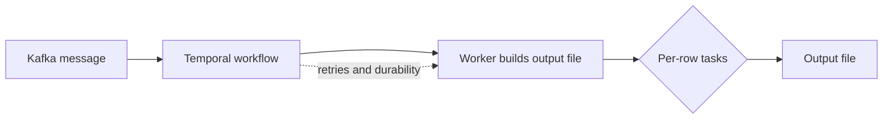
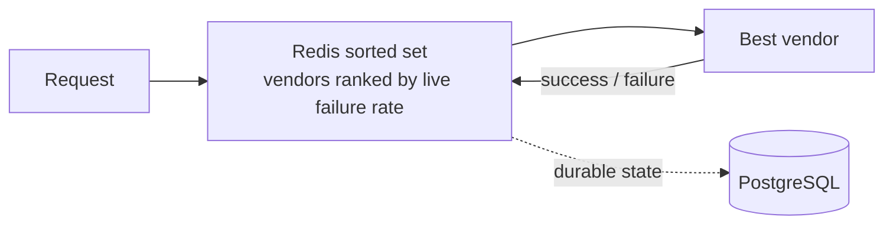

  

---

## 📈 Impact

| | What I built | Where |
|---|---|---|
| 💸 | Wallet write-off flow to reconcile unrecoverable payment amounts | Flipkart |
| 🛒 | Moved payment services from VMs to Kubernetes, load-tested for Big Billion Days | Flipkart |
| 📈 | Temporal + Kafka framework for resilient bulk-file processing | Yubi |
| 🔔 | Firebase push framework (mobile + web) | Yubi |
| 📉 | Golang → Java migration of the notification service, killed AWS Lambda | Yubi |

---

## 🧠 How I design systems

Conceptual patterns, not proprietary code.

---

## 🚀 Projects

- 🎬 **AdSlot AI**: FastAPI + Whisper + Claude API, recommends ad-break timestamps from video transcripts
- 🛡️ **Incident Risk Assessment**: LangGraph + RAG flags risky deploys against past incidents
- 🔐 **PrivacyGuard**: LLM-generated PII exposure reports on Kubernetes
- ⚙️ **MarketGen**: n8n + Supabase content automation for images, blogs, videos

---

## 🛠️ Stack

Temporal · LangGraph · LangChain · RAG · Pinecone · Claude API · n8n · Supabase

